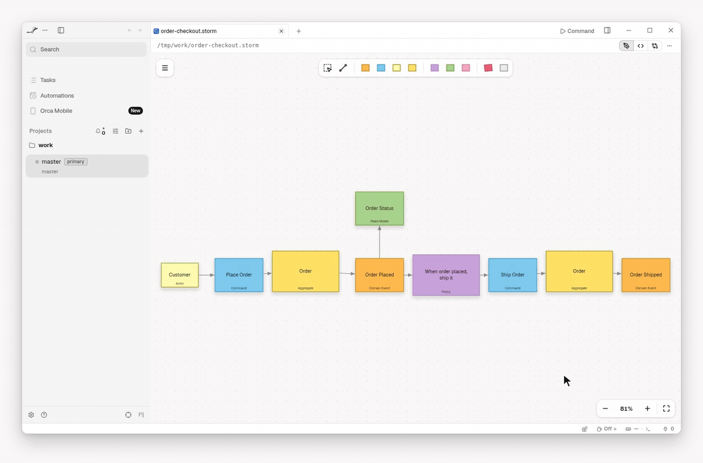

# Miragon modelers for Orca

[](https://www.onorca.dev/plugins/miragon/orca-modelers)
[](https://github.com/Miragon/orca-modelers/actions/workflows/validate.yml)
[](LICENSE)

<!-- Hero placeholder: a branded banner for the whole collection (name, claim, a modeler at work in Orca). Make it with the product-shots skill of miragon-brand. -->

**See the diagrams your agent writes, and edit them right next to it.**

Plugins for [Orca](https://www.onorca.dev) that open Wardley maps, Event Storming boards, team
topologies, context maps, value chains, BPMN processes and DMN decisions as diagrams instead of text
you have to picture in your head. All are early versions, before 1.0.

## What you get

- **Files you can review.** Every diagram is a small text file: diff it, review it in a pull
  request, keep it next to the code it describes.
- **Sandboxed.** The modelers can't reach the network or read files beyond the one you open.
- **Live while your agent writes.** Its changes appear on the canvas at once.



## The modelers

| Modeler                                                                                                                                                                | Opens              | Get it                                                                                       |
| ---------------------------------------------------------------------------------------------------------------------------------------------------------------------- | ------------------ | -------------------------------------------------------------------------------------------- |
| [Event Storming](https://github.com/Miragon/modeler-suite/tree/main/modelers/event-storming/apps/orca#readme)                                                          | `.storm`           | [Open in Orca](https://www.onorca.dev/plugins/miragon/orca-modelers/event-storming-modeler)  |
| [Wardley Maps](https://github.com/Miragon/modeler-suite/tree/main/modelers/wardley-maps/apps/orca#readme)                                                              | `.wmap`, `.owm`    | [Open in Orca](https://www.onorca.dev/plugins/miragon/orca-modelers/wardley-maps-modeler)    |
| [Team Topologies](https://github.com/Miragon/modeler-suite/tree/main/modelers/team-topologies/apps/orca#readme)                                                        | `.tt`, `.ttm.json` | [Open in Orca](https://www.onorca.dev/plugins/miragon/orca-modelers/team-topologies-modeler) |
| [Context Maps](https://github.com/Miragon/modeler-suite/tree/main/modelers/context-maps/apps/orca#readme)                                                              | `.cm`, `.cm.json`  | [Open in Orca](https://www.onorca.dev/plugins/miragon/orca-modelers/context-maps-modeler)    |
| [Value Chain](https://github.com/Miragon/modeler-suite/tree/main/modelers/value-chain/apps/orca#readme)                                                                | `.vc`, `.vc.json`  | [Open in Orca](https://www.onorca.dev/plugins/miragon/orca-modelers/value-chain-modeler)     |
| [BPMN & DMN](https://miragon.github.io/bpmn-modeler/orca/getting-started), experimental ([limits](https://miragon.github.io/bpmn-modeler/orca/getting-started#limits)) | `.bpmn`, `.dmn`    | [Open in Orca](https://www.onorca.dev/plugins/miragon/orca-modelers/bpmn-modeler)            |
| [C4](https://miragon.github.io/modeler-suite/modelers/c4)                                                                                                              | `.c4`, `.dsl`      | Not in Orca yet                                                                              |

## Install

You need [Orca](https://www.onorca.dev) 1.4.252 or later. Turn on plugins once in Orca's settings,
under **Plugins**.

- **From Orca's plugin directory:** click **Open in Orca** in the table above, or search for
  **Miragon** in the plugin settings.
- **From this catalog**, for the newest releases: add `https://github.com/miragon/orca-modelers.git`
  with ref `main` as a catalog source, through the **⋯** menu of the plugin settings.

Updates arrive through the source you installed from.

## Get started

1. Open a file with one of the extensions above, or ask your agent to create one.
2. Ask your agent to change it, for example "add a payment step to checkout.storm".
3. Watch the change appear on the canvas, then edit it yourself and save; if the agent writes into
   your unsaved edits, Orca may ask which version to keep.

## With your AI assistant

If your agent is Claude Code, plugins for Wardley Maps, Event Storming and Team Topologies teach it
the file format and the method, so it can draft a map or review a board:

```text
/plugin marketplace add Miragon/modeler-suite
/plugin install wardley-maps-modeler@modeler-suite
/plugin install event-storming-modeler@modeler-suite
/plugin install team-topologies-modeler@modeler-suite
```

## Help and feedback

- **Documentation:** [miragon.github.io/modeler-suite](https://miragon.github.io/modeler-suite/),
  and each modeler's guide in [the table](#the-modelers).
- **Bugs and ideas:** open an issue in
  [Miragon/modeler-suite](https://github.com/Miragon/modeler-suite/issues), or in
  [Miragon/bpmn-modeler](https://github.com/Miragon/bpmn-modeler/issues) for BPMN and DMN.
- **Security:** report vulnerabilities privately, as described in [SECURITY.md](SECURITY.md).

## Contributing

Changes to a modeler go to its source repository; how releases reach this catalog is in
[CONTRIBUTING.md](CONTRIBUTING.md).

## License

[MIT](LICENSE) © Miragon
